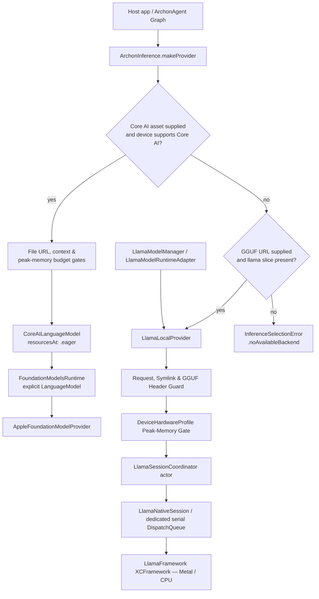

# ArchonInference — how it works

`ArchonInference` is an optional on-device inference product with exactly two
runtime choices behind `ArchonInference.makeProvider(...)`: Apple Core AI
first, then [ggml-org/llama.cpp](https://github.com/ggml-org/llama.cpp)
(`LlamaFramework`). It is excluded from `ArchonFull` so applications opt in
explicitly.

Core AI preparation errors propagate instead of silently falling back to GGUF.
No `llama` C pointer or C struct enters ArchonKit's public Swift API, and no
weights are downloaded by either path. Model memory budgets, symlink checks,
and GGUF header validation execute before weight allocation.
