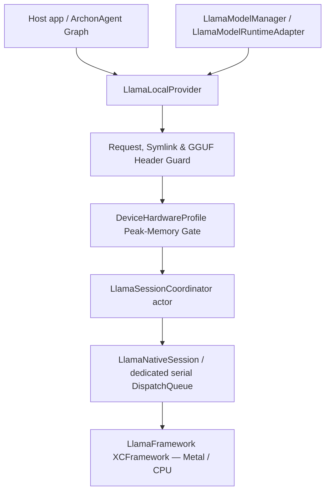

# ArchonInference — how it works

`ArchonInference` is an optional local GGUF inference adapter that wraps
[ggml-org/llama.cpp](https://github.com/ggml-org/llama.cpp) (`LlamaFramework`)
behind `ArchonAgent`'s `LLMProvider` and `ArchonModels`'s `ModelRuntimeAdapter`.
It is excluded from `ArchonFull` so applications opt in explicitly.

No `llama` C pointer or C struct enters ArchonKit's public Swift API. Model
memory budgets, symlink checks, and GGUF header validation execute before weight
allocation.
