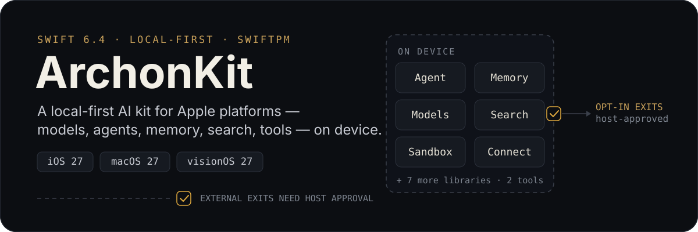
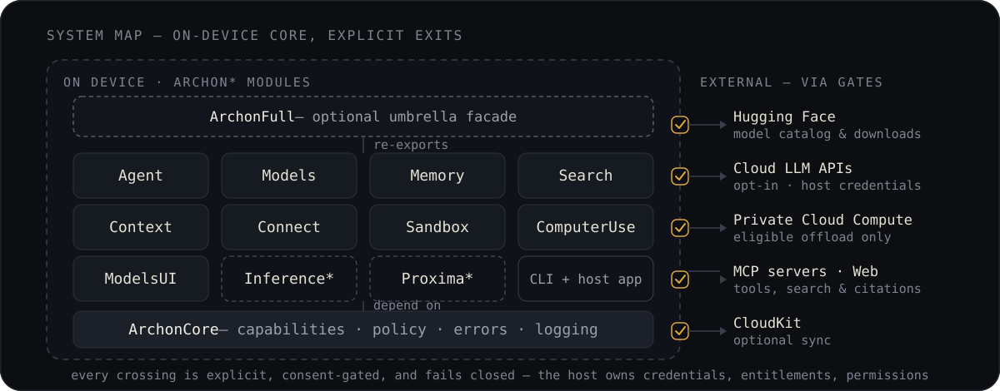

<p align="center">
  
</p>

<p align="center">
  <a href="https://www.swift.org"></a>
  <a href="https://developer.apple.com"></a>
  <a href="https://github.com/VM451/ArchonKit/actions/workflows/ci.yml"></a>
</p>

ArchonKit is a modular, local-first Swift SDK for building native AI features
on Apple platforms. Model lifecycle, agent graphs, context budgeting, durable
memory, search, sandboxed tools, MCP, semantic computer use, and SwiftUI
surfaces — as thirteen independently adoptable libraries plus an optional
`ArchonFull` umbrella. The consuming app keeps the boundary: credentials,
entitlements, and permissions stay with the host.

<p align="center">
  
</p>

Every number below comes from the opt-in suite in
[`Benchmarks/`](Benchmarks/README.md) on a deterministic workload — not a
synthetic token-throughput claim.

**iPhone 16, iOS 27.0 (Debug), 10,000 × 384-dim clustered corpus:**

| Engine | Query median / p95 | Recall@10 |
| --- | ---: | ---: |
| `ArchonMemoryProxima`, `efSearch=64` | **0.88 / 0.99 ms** | 1.000 |
| `ArchonMemoryProxima`, `efSearch=256` | 4.29 / 4.82 ms | 1.000 |
| USearch (`f91fe5bc`, cosine/f32) | 2.55 / 2.81 ms | 1.000 |

→ ~2.8× faster than USearch at equal recall on the identical corpus, queries,
and ground truth.

**macOS arm64 Apple Silicon, same 10k × 384 workload vs Wax `36605ff`:**

| Engine | Ingest | Steady p95 | Recall@10 |
| --- | ---: | ---: | ---: |
| ArchonKit `LocalVectorStore` | **5.8 s** | **9.1 ms** | 1.000 |
| Wax | 36.9 s | 12.9 ms | 1.000 |

→ ~6.4× faster ingest, ~1.4× faster p95, equal recall.

All thirteen products are verified — local `swift build --target` loops plus
verify scripts, with MLX/Metal targets green on the CI `xcode-27` runner. The
full contract table and commands live in
[`VerificationReport.md`](VerificationReport.md).

## Why it's built this way

- **Local-first by construction.** Inference, memory, and search run on
  device. Every external call — cloud LLMs, MCP servers, the web, CloudKit —
  crosses an explicit, host-approved gate and fails closed.
- **Apple first, honestly.** The governing rule: use Apple when Apple already
  solves the problem, add only the missing adapter when it does not, and
  report unsupported behavior when no safe adapter exists. Each product ships
  an honest-winner verdict against its rivals in the
  [competitor comparison](Documentation/reference/competitor-comparison.md) —
  ArchonKit wins some rows on local-first grounds and honestly loses others on
  hosted scale.
- **Bounded and typed.** Swift 6 strict concurrency throughout, typed errors,
  resource and request-size limits on catalogs, tools, providers, and the
  vector store.

## How it works

<p align="center">
  
</p>

Each product depends on `ArchonCore` and nothing you don't import. `ArchonFull`
is a convenience facade over the base graph; `ArchonInference` and
`ArchonMemoryProxima` stay opt-in. Per-product diagrams live in
[`Documentation/diagrams/`](Documentation/diagrams/) and the compatibility
entry point is [`Documentation/architecture.md`](Documentation/architecture.md).

<p align="center">
  
</p>

| Product | What it does |
| --- | --- |
| `ArchonCore` | Capabilities & device facts · unified policy & error layer · logging & identifiers |
| `ArchonModels` | Model catalogs & manifests · resumable downloads & lifecycle · device compatibility |
| `ArchonAgent` | Stateful graphs & tool routing · handoffs, guardrails & checkpoints · realtime voice/vision · 20+ API-key cloud providers · bundled MLX local inference |
| `ArchonContext` | Request-scoped context assembly · token budgeting & truncation · never persists or executes |
| `ArchonMemory` | Durable fact lifecycle & graph · vector search & hybrid RAG · research archive · optional CloudKit sync |
| `ArchonMemoryProxima` | Optional ProximaKit dense-index adapter behind `VectorIndex` |
| `ArchonInference` | On-device provider selection — Apple Core AI first, `llama.cpp` GGUF second · pure-Swift GGUF header & memory gate · GBNF JSON & tool-call boundaries |
| `ArchonSearch` | Local-first search & crawling · 14-channel Agent Reach (GitHub, YouTube, X, Reddit, and more) · neural & keyword reranking · grounded citations & chat UI |
| `ArchonSandbox` | Restricted WebKit mini-apps · scoped capability grants · workspace sync & audit stream |
| `ArchonConnect` | MCP client & transports · schema validation · permissioned tools, resources & prompts |
| `ArchonComputerUse` | Semantic accessibility snapshots · approval & risk classification · host actions with postconditions — no coordinate taps |
| `ArchonModelsUI` | SwiftUI model browser & library · model details, storage & download management |
| `ArchonFull` | Optional umbrella re-export of the base graph · excludes `ArchonInference` and `ArchonMemoryProxima` |

Developer tools: `archon-model` (offline model workflows: catalog lint,
device-fit dry runs, prep recipes, artifact benchmarks) and
`archon-example-app` (a SwiftUI host for integration validation). Both are
BUILD-verified on the CI `xcode-27` runner.

<p align="center">
  
</p>

Add the package in Xcode or `Package.swift`:

```swift
// For development; pin a tag or commit for production.
.package(url: "https://github.com/VM451/ArchonKit.git", branch: "main")
```

Import the smallest product set that owns the capability — `ArchonFull` only
when the convenience facade is worth the full base graph:

```swift
import ArchonCore
import ArchonModels

// Discover local MLX models already on disk — no network, no cloud.
let catalog = MLXModelCatalog(provider: LocalModelCatalog(locations: [directory]))
let models = try await catalog.search(
    ModelSearchRequest(
        query: "",
        runtime: .mlx,
        format: .mlx,
        compatibleOnly: true,
        device: ArchonDeviceCapabilities.current
    )
)
```

Then inspect and import only after validation; the library stages the artifact
before its atomic install:

```swift
let library = ModelLibrary.makeDefault()
let inspection = try await library.inspectArtifact(at: artifactURL)
let installed  = try await library.importArtifact(at: artifactURL)
```

See the full walkthrough in
[`Documentation/tutorials/first-local-model.md`](Documentation/tutorials/first-local-model.md),
or launch the golden host on macOS:

```bash
swift run archon-example-app
```

## Limits and boundaries

- **Toolchain:** the MLX/Metal targets (`ArchonAgent`, `ArchonFull`,
  `ArchonInference`, the example host) require an Xcode 27+ toolchain; the
  non-MLX products build with Command Line Tools.
- **Deployment targets:** iOS 27, macOS 27, visionOS 27.
- **The example app is a SwiftPM host, not a signed `.app`** — iOS and
  visionOS validation need a consuming Xcode application that supplies
  entitlements and privacy usage descriptions.
- **Benchmarks are opt-in** (`ARCHON_ENABLE_BENCHMARKS=1`) so normal builds
  and CI stay bounded; the package does not report synthetic token throughput.
- **The host owns the boundary:** credentials, entitlements, permissions, and
  remote adapters belong to the consuming application, by design.

## Documentation

- [`Documentation/README.md`](Documentation/README.md) — index organized by tutorials, how-to, reference, explanation, and decisions
- [`Documentation/reference/supported-models.md`](Documentation/reference/supported-models.md) — official-publisher MLX discovery and model-family policy
- [`Documentation/reference/products/inference.md`](Documentation/reference/products/inference.md) — Apple Core AI first, llama.cpp GGUF as the only fallback
- [`Documentation/reference/products.md`](Documentation/reference/products.md) — the complete product map and adoption decisions
- [`Documentation/reference/decision-framework.md`](Documentation/reference/decision-framework.md) — the BUILD / ADAPT / REUSE vocabulary
- [`Examples/README.md`](Examples/README.md) — what the example host covers (and what it does not)
- [`CHANGELOG.md`](CHANGELOG.md) — recent changes and migration notes

## Security

ArchonKit is local-first; security-sensitive surfaces are credential handling,
artifact validation, network destination policy, tool effects, sandbox
capabilities, and privacy behavior. Report vulnerabilities privately per
[`SECURITY.md`](SECURITY.md) — do not publish exploit details in a public
issue.

## License

No `LICENSE` file is published in this repository yet; treat the code as
all-rights-reserved until one lands.
