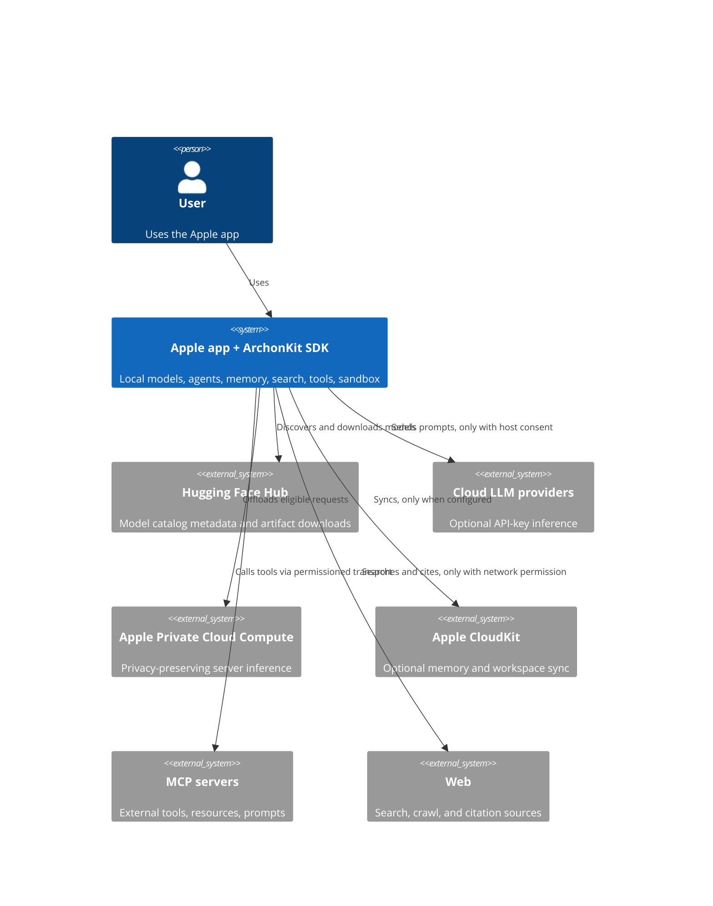

# ArchonKit

ArchonKit is a modular, local-first Swift SDK for building native AI features on
Apple platforms. It composes model lifecycle, agent graphs, context, memory,
research, tools, sandboxing, MCP, semantic actions, and SwiftUI surfaces.

Each product is independently adoptable. `ArchonFull` is the optional
all-base-products re-export; optional adapters remain separate.

## At a glance

| Property | Value |
| --- | --- |
| Language | Swift 6.4, strict-concurrency settings |
| Platforms | iOS 27, macOS 27, visionOS 27 |
| Package manager | Swift Package Manager |
| Runtime posture | MLX Swift and Hugging Face/Transformers support is bundled with `ArchonAgent` for out-of-the-box local inference; user-facing browsing is official-publisher MLX-only |
| Default safety posture | Typed errors, bounded operations, fail closed |
| App boundary | The consuming app owns credentials, entitlements, permissions, and host adapters |

## System context (C4 Level 1)

The system in scope is a native Apple app with the ArchonKit SDK embedded. It
runs local-first on device and talks to external systems only through
explicit, host-approved boundaries.

Level 1 only: people, the system, and external systems. Internal structure
(products, SwiftPM graph, runtime adapters) lives one level down in
[`Documentation/architecture.md`](Documentation/architecture.md) and the
per-product diagrams under [`Documentation/diagrams/`](Documentation/diagrams/).

## Products

One row per product: what it does, the build decision, and the reuse-or-audit
first action. The full decision vocabulary and dependency policy live in the
[decision framework](Documentation/reference/decision-framework.md). A link is
an audit target, not an adoption decision — `BUILD` means ArchonKit owns the
missing local behavior after the audit; it never means Apple APIs are ignored.

The `Honest winner` column is a plain-language verdict per row. ArchonKit runs
locally on the user's device with no required hosting, so it wins some rows
on local-first grounds and honestly loses others on hosted scale or ecosystem
maturity — that tradeoff is intentional. Scores and evidence live in the
[competitor comparison](Documentation/reference/competitor-comparison.md);
latency/recall device proof lives in [Benchmarks](Benchmarks/README.md).

| Product | What it does | Honest winner | Decision | Reuse or audit first |
| --- | --- | --- | --- | --- |
| ⚙️ `ArchonCore` | • Capabilities & device facts • Unified policy & error layer • Logging & identifiers | 🤝 Split — Apple/upstream wins primitives (reused by design); ArchonKit wins the unified policy/error layer | PARTIAL / ADAPT | Apple facts; • [swift-foundation](https://github.com/apple/swift-foundation) • [swift-system](https://github.com/apple/swift-system) • [swift-log](https://github.com/apple/swift-log) • [swift-crypto](https://github.com/apple/swift-crypto) |
| 📦 `ArchonModels` | • Model catalogs & manifests • Formats & device compatibility • Resumable downloads & lifecycle | 🤝 Split — Hugging Face wins catalog breadth; ArchonKit wins native lifecycle + official-publisher MLX browsing, now with prep recipes and measured benchmarks | PARTIAL / ADAPT | Apple runtimes; • [mlx-swift](https://github.com/ml-explore/mlx-swift) • [mlx-swift-lm](https://github.com/ml-explore/mlx-swift-lm) • [swift-huggingface](https://github.com/huggingface/swift-huggingface) • [swift-transformers](https://github.com/huggingface/swift-transformers) • [coreai-model-zoo](https://github.com/john-rocky/coreai-model-zoo) |
| 🤖 `ArchonAgent` | • Stateful graphs & tool routing • Handoffs, guardrails & checkpoints • Realtime voice/vision sessions • 20+ API-key cloud providers | 🏆 ArchonKit on-device — durability, handoffs, guardrails, eval, full-duplex realtime sessions, broad cloud-provider coverage proven; LangGraph still leads hosted/Python ecosystem maturity | BUILD | • [langgraph](https://github.com/langchain-ai/langgraph), [crewAI](https://github.com/crewAIInc/crewAI) • [openai-agents-python](https://github.com/openai/openai-agents-python) • [AgentRunKit](https://github.com/Tom-Ryder/AgentRunKit), [Conduit](https://github.com/christopherkarani/Conduit) • Realtime: [livekit](https://github.com/livekit/livekit) / [client-sdk-swift](https://github.com/livekit/client-sdk-swift), [pipecat](https://github.com/pipecat-ai/pipecat), [TEN](https://github.com/TEN-framework/TEN-Agent) • STT candidate: [WhisperKit](https://github.com/argmaxinc/WhisperKit) |
| 📑 `ArchonContext` | • Request-scoped context assembly • Token budgeting & truncation • Never persists or executes | 🏆 ArchonKit — no local rival; token profiles, summarization seam, latency budgets extend the lead | BUILD | • [mem0](https://github.com/mem0ai/mem0) • [letta](https://github.com/letta-ai/letta) • [zep](https://github.com/getzep/zep) |
| 🧠 `ArchonMemory` | • Durable fact lifecycle & graph • Vector search & hybrid RAG • Source-linked research archive • Optional CloudKit sync | 🏆 ArchonKit on-device — beats Wax (6.4x ingest, 1.4x p95, equal recall); hybrid ranking + temporal supersession extend the lead; hosted rivals win zero-ops convenience | ADAPT + BUILD | GRDB + existing stores; • [mem0](https://github.com/mem0ai/mem0), [supermemory](https://github.com/supermemoryai/supermemory) • [graphiti](https://github.com/getzep/graphiti), [letta](https://github.com/letta-ai/letta) • [Wax](https://github.com/christopherkarani/Wax) • [ProximaKit](https://github.com/vivekptnk/ProximaKit), [RecallKit](https://github.com/gregyoung14/RecallKit) |
| ⚡️ `ArchonMemoryProxima` | • ProximaKit dense-index adapter • Fast local vector search • Behind unified VectorIndex | 🏆 ArchonKit leads — beats USearch 2.8x on iPhone 16 at equal recall; stays optional until ceiling/device gates close | PARTIAL / ADAPT | • [ProximaKit](https://github.com/vivekptnk/ProximaKit) • [RecallKit](https://github.com/gregyoung14/RecallKit) • [Wax](https://github.com/christopherkarani/Wax) (device fit first) |
| 🔎 `ArchonSearch` | • Local-first search & crawling • 14-channel Agent Reach (GitHub, YouTube, X, Reddit, Bilibili, V2EX, Xiaoyuzhou, Xueqiu, LinkedIn, Boss, Facebook, Instagram, Xiaohongshu, Web) • Neural & keyword reranking • Web extraction & citations • Grounded search chat UI | 🤝 Split — rivals win whole-web scale (structural); ArchonKit wins offline corpus, privacy, explicit policy; local rerank, 14-channel reach, + answer evals narrow the quality gap | PARTIAL / ADAPT | DuckDuckGo engine; • Native channel reach (`AgentReachClient` + Jina/Exa fallbacks) • Local reranker / query rewriter • [SwiftSoup](https://github.com/scinfu/SwiftSoup) + Readability bridge • [GRDB](https://github.com/groue/GRDB.swift) • Companions: [searxng](https://github.com/searxng/searxng), [crawl4ai](https://github.com/unclecode/crawl4ai) • Audit: [Agent-Reach](https://github.com/Panniantong/Agent-Reach), [tavily-python](https://github.com/tavily-ai/tavily-python), [exa-py](https://github.com/exa-labs/exa-py), [firecrawl](https://github.com/mendableai/firecrawl), [Perplexica](https://github.com/ItzCrazyKns/Perplexica) |
| 🛡️ `ArchonSandbox` | • Restricted WebKit mini-apps • Scoped capability grants • Workspace sync & audit stream | 🤝 Split — rivals win isolation strength (microVM, structural); ArchonKit wins native in-process embedding + policy; capability grants, audit stream, WASM path extend it | BUILD | WebKit; • [e2b](https://github.com/e2b-dev/e2b) • [modal-client](https://github.com/modal-labs/modal-client) • [daytona](https://github.com/daytonaio/daytona) • [deno](https://github.com/denoland/deno) |
| 🔌 `ArchonConnect` | • MCP client & transports • Schema validation & permissions • Tools, resources & prompts | 🤝 Split — official SDK wins wire protocol (adapted); ArchonKit wins permission/policy + hosted capabilities; teardown + conformance probes harden the adapter | PARTIAL / ADAPT | • [swift-sdk](https://github.com/modelcontextprotocol/swift-sdk) • Audit: [servers](https://github.com/modelcontextprotocol/servers) |
| 🖥️ `ArchonComputerUse` | • Semantic accessibility snapshots • Approval & risk classification • Host actions & postconditions | 🤝 Split — rivals win automation breadth; ArchonKit wins semantic-first safety (approvals, postconditions, catalogued actions, no coordinate taps) | BUILD | Accessibility / DOM / App Intents; • [stagehand](https://github.com/browserbase/stagehand) • [anthropic-cookbook](https://github.com/anthropics/anthropic-cookbook) |
| 🎨 `ArchonModelsUI` | • SwiftUI model browser & library • Model details & storage views • Download progress & management | 🤝 Split — LM Studio/Jan win full-app UX maturity; ArchonKit wins embeddable native SwiftUI, now with benchmark badges + storage analytics | BUILD | SwiftUI; • [swift-book](https://github.com/apple/swift-book) • [swift-navigation](https://github.com/pointfreeco/swift-navigation) |
| 🗃️ `ArchonFull` | • Umbrella SDK re-export facade • Convenient single import • Excludes optional adapters | — (facade; no matchup) | REUSE | Dependency scope only |

Developer tools: `archon-model` (offline model workflows via
[swift-argument-parser](https://github.com/apple/swift-argument-parser)) and
`archon-example-app` (golden SwiftUI host) are both BUILD, reusing the
patterns above.

## Documentation

- [`Documentation/README.md`](Documentation/README.md) — documentation index organized by tutorials, how-to guides, reference, explanation, and decisions.
- [`Documentation/architecture.md`](Documentation/architecture.md) — compatibility entry point for focused architecture documents.
- [`Documentation/model-format.md`](Documentation/model-format.md) — compatibility entry point for model contracts, catalogs, and lifecycle.
- [`Documentation/migration-audit.md`](Documentation/migration-audit.md) — compatibility entry point for the migration decision record.
- [`Documentation/tutorials/`](Documentation/tutorials/) — end-to-end local model tutorial.
- [`Documentation/how-to/`](Documentation/how-to/) — integration, lifecycle, MCP, sandbox, semantic action, and release guides.
- [`Documentation/reference/`](Documentation/reference/) — product, model, policy, and executable contracts.
- [`Documentation/reference/supported-models.md`](Documentation/reference/supported-models.md) — official-publisher MLX discovery, supported model families, catalog wiring, and the Gemma compatibility explanation.
- [`Documentation/reference/competitor-comparison.md`](Documentation/reference/competitor-comparison.md) — detailed competitor feature tables, scores, and ArchonKit-fit decisions.
- [`Documentation/reference/products/memory.md`](Documentation/reference/products/memory.md) — ArchonMemory contracts, durable research imports, and local feedback boundaries.
- [`Documentation/explanation/`](Documentation/explanation/) — architecture, dependency, local-first, and recovery rationale.
- [`Documentation/decisions/`](Documentation/decisions/) — migration and architectural decision records.
- [`Documentation/diagrams/archon-search.md`](Documentation/diagrams/archon-search.md) — ArchonSearch 2.0 dual-retrieval and grounding architecture.
- [`Documentation/diagrams/archon-memory.md`](Documentation/diagrams/archon-memory.md) — durable memory, RAG, competitive research, stale-refresh, and export flow.
- [`Documentation/how-to/validate-a-release.md`](Documentation/how-to/validate-a-release.md) — replacement gates for correctness, safety, performance, and migration.
- [`Examples/README.md`](Examples/README.md) — buildable SwiftUI host.
- [`Benchmarks/README.md`](Benchmarks/README.md) — opt-in performance checks.

## Governing rule

Use Apple when Apple already solves the problem. Add only the missing adapter
when it does not. Report unsupported behavior honestly when no safe adapter
exists.
